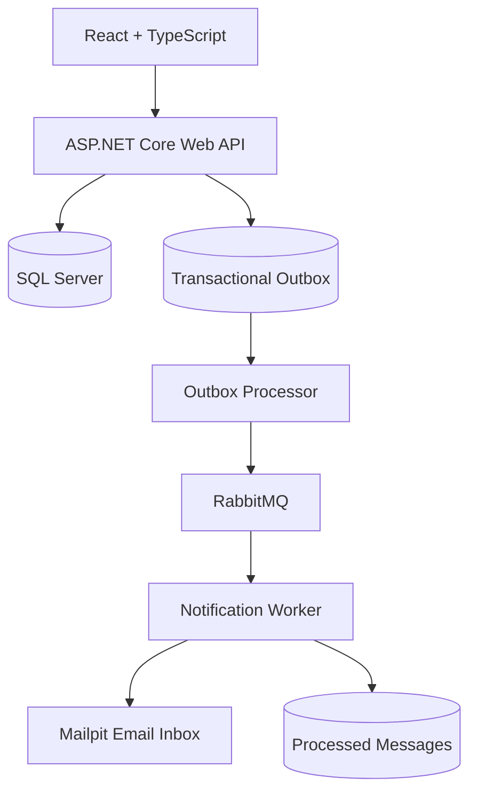
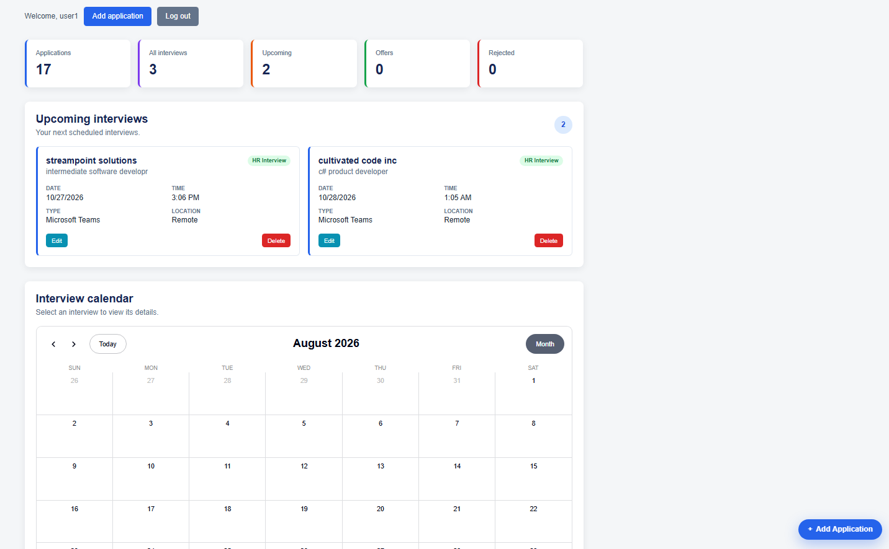
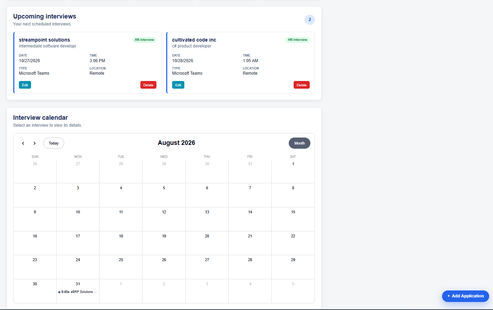
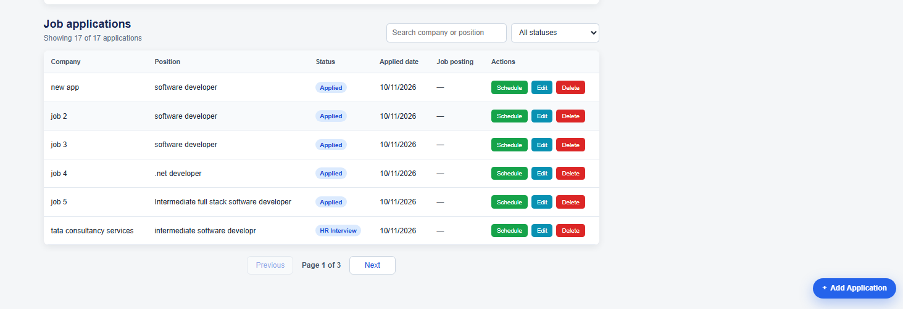

# Interview Tracker

A full-stack application for tracking job applications and scheduling interviews.

## Technology Stack

- React and TypeScript
- ASP.NET Core Web API
- Entity Framework Core
- SQL Server
- RabbitMQ
- .NET Worker Service
- Mailpit
- Docker and Docker Compose
- JWT authentication

## Architecture

1. React sends authenticated requests to the ASP.NET Core API.
2. The API stores job applications and interviews in SQL Server.
3. Interview creation stores an event in the Outbox table in the same transaction.
4. The Outbox processor publishes pending events to RabbitMQ.
5. The Notification Worker consumes RabbitMQ events.
6. The Worker sends email through Mailpit.
7. Processed event IDs are recorded to prevent duplicate emails.
8. Failed messages are retried and eventually moved to a dead-letter queue.

## Reliability Features

- Transactional Outbox pattern
- Idempotent Inbox/consumer pattern
- Durable RabbitMQ queues
- Controlled email retries
- Dead-letter queue
- RabbitMQ connection recovery
- API liveness and readiness checks
- Persistent Docker volumes

## Local Docker Setup

### Requirements

- Docker Desktop
- Docker Compose

### Configuration

Create a root `.env` file:

```env
MSSQL_SA_PASSWORD=your-strong-development-password
RABBITMQ_USER=interviewuser
RABBITMQ_PASSWORD=your-rabbitmq-password
JWT_KEY=your-long-jwt-signing-key
```

### Start the Application

From the project root, run:

```powershell
docker compose -f compose.full.yaml up -d --build
```

### Access the Application

| Service | URL |
|---|---|
| React Frontend | http://localhost:5173 |
| ASP.NET Core API | http://localhost:5253 |
| Mailpit Email Inbox | http://localhost:8026 |

### Stop the Application

```powershell
docker compose -f compose.full.yaml down
```

Docker volumes are preserved when stopping without the -v option.


## Architecture Diagram



## Application Screenshots

### Dashboard


### Interview Calendar


### Job Applications


## Technical Documentation

For a detailed explanation of the project structure, architecture,
authentication, database design, RabbitMQ messaging, and Docker setup, see:

[Technical Architecture and Project Structure](docs/TECHNICAL_OVERVIEW.md)
